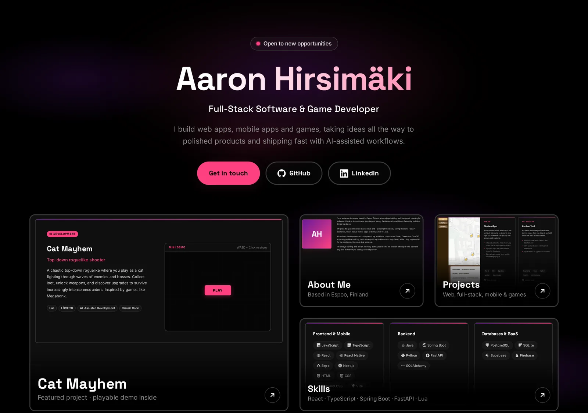

# Aaron Hirsimäki — Portfolio

Personal portfolio of a Full-Stack Developer from Espoo, Finland, open to software developer / engineer roles.

**Live site:** https://aaronhirsimaki.github.io/portfolio/



## Highlights

- **A retro desktop.** The site is a Windows 95-style desktop: open the icons (or the Start menu) to get
  floating windows you can drag, resize, minimise to the taskbar, maximise and close. Each window has its
  own URL (`#projects`, `#skills`…) so it can be shared as a link, and the browser Back button closes the
  window you just opened.
- **Playable mini-game.** `CatMayhem.exe` runs a small canvas demo of my in-development roguelike
  *Cat Mayhem* (WASD to move, click to shoot; drag to move on touch screens).
- **Retro sounds, zero audio files.** Optional chiptune blips are synthesised with the Web Audio API.
  Off by default, toggled from the speaker in the taskbar.
- **Accessible.** Icons, taskbar and Start menu are fully keyboard-operable (arrow keys in the menu, Escape
  closes the front window), focus moves with the windows, and `prefers-reduced-motion` is respected.
- **No build step, no framework.** Plain HTML, CSS and JavaScript. Pixel-art icons are hand-made inline SVG,
  and the UI uses system fonts, so there are no web fonts to download.

## Tech

| Area | Details |
| --- | --- |
| Markup | Semantic HTML, Open Graph / Twitter card meta, one inline SVG sprite for all icons |
| Styling | CSS custom properties for the palette and the four bevel styles, BEM naming, CSS Grid |
| Behaviour | Vanilla JS window manager (z-order, drag, minimise/maximise, taskbar), hash routing with History API Back/Forward, Web Audio sounds, delta-time canvas game loop with HiDPI scaling |
| Icons | Pixel-art SVG sprite; [Devicon](https://devicon.dev/) for skill logos (pinned, loaded without blocking render) |
| Hosting | GitHub Pages |

## Project structure

```
index.html        Desktop, windows, taskbar and Start menu markup + icon sprite
css/style.css     Retro theme: palette, bevels, windows, taskbar, responsive layout
js/main.js        Window manager, Start menu, clock, sounds, Cat Mayhem mini-game
assets/           Favicons, social preview image, project screenshots
```

## Running locally

Any static file server works:

```bash
python3 -m http.server 8000
# open http://localhost:8000
```

## Contact

- Email: aaron.hirsimaki@proton.me
- LinkedIn: [Aaron Hirsimäki](https://www.linkedin.com/in/aaron-hirsim%C3%A4ki-848155268)
- GitHub: [AaronHirsimaki](https://github.com/AaronHirsimaki)
